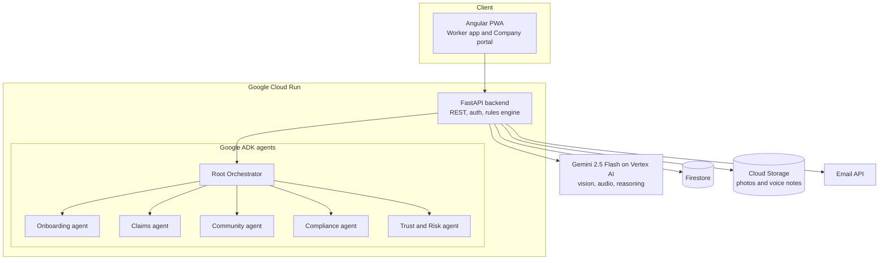

# Other/Brother

> **When an Other becomes a Brother.**

An AI-powered safety net for delivery and ride workers, built by **Team BitBuddies** for the **Google Cloud AI Builder Cup** (Hack2skill). Theme: **BFSI: Intelligent Risk, Fraud and Financial Experiences**.

| | |
|---|---|
| **Live app** | https://other-brother-web-288097280823.asia-south1.run.app/ |
| **API docs (Swagger)** | https://other-brother-api-288097280823.asia-south1.run.app/docs |
| **Demo video** | https://drive.google.com/drive/folders/166bJARDir24Kokgb5t1RvvUWGxVI--vx |
| **Team leader** | Voni Purujit |

---

## The problem

Delivery riders keep our cities moving, but when a bike crashes, when illness strikes, or when the money runs out, they face it alone. They joined gig work out of need. They have no salary slip, no safety net, and no easy access to insurance or credit.

## The solution

One app that stands by a gig worker on their worst day:

- **Claims Autopilot:** snap a photo and record a 10-second voice note. Gemini assesses the damage, estimates the repair cost, rates fraud risk, and files the claim.
- **Ask Your Other/Brother Here:** nearby workers help each other with money, items or medicine, paid directly by UPI. The app never holds money.
- **Community Pool:** emergency money limited by trust score, with repayment tracking.
- **Explainable Trust Score:** a 0 to 100 score where every change is logged with a reason.
- **Strict registration:** Gemini reads the ID, a live selfie is face-matched, and the worker's own company confirms them.

> **Design principle:** AI reads and explains. Fixed rules and company confirmation make the final call. If Gemini fails or returns a bad format, the request is rejected, never approved.

---

## Features

| Area | What it does |
|---|---|
| Registration | ID read by Gemini, live selfie face match, tamper and duplicate checks, name cross-match, company confirmation, 3 failed attempts lead to a 24-hour block |
| Claims | Photo plus voice note, AI damage assessment, repair estimate, fraud-risk rating with a reason, high-risk claims blocked, live status timeline |
| Community Pool | Trust-score limits, one open request at a time, repayment tracking, live pool balance |
| Peer-to-peer help | Requests reach workers within 5 km, requester UPI revealed only after acceptance, optional thank-you bonus (max 20%), return date, overdue handling, dispute option |
| Helper rewards | Points for confirmed help, leaderboard, anti-cheating for repeated same-pair help |
| Trust Score | Explainable score with an event log, drives limits |
| Income and schemes | Income added across platforms, scheme eligibility check, one-click monthly filing |
| Help and Support | Worker sends a request, the company portal replies |
| Company Portal | Confirm or reject new workers, answer help requests, approval email to the worker |
| Languages | 12 languages (en, hi, bn, ta, te, kn, mr, id, vi, th, fil, ms), voice notes in any language |
| Privacy | ID stored only as a hash and the last 4 digits, exact location never shared (only distance) |

---

## Architecture



**Request flow:** the Angular app calls the FastAPI backend. Money, approvals and limits are decided by Python rules. Gemini is used for understanding (documents, faces, photos, audio) and for plain-language reasons.

---

## Tech stack

| Layer | Technology |
|---|---|
| AI | Gemini 2.5 Flash on Vertex AI |
| Agents | Google Agent Development Kit (ADK) |
| Backend | Python, FastAPI, Pydantic |
| Database | Firestore |
| Storage | Cloud Storage |
| Hosting | Cloud Run (backend and frontend), Cloud Build, Artifact Registry |
| Frontend | Angular (mobile-first PWA), 12 languages |
| Location | Browser Geolocation API (distance only) |
| Payments | UPI deep links and QR (worker to worker) |
| Email | HTTPS email API (Brevo), Gmail address as the sender |
| Auth | Firebase Authentication (phone OTP). The hosted demo also accepts demo tokens through `DEMO_MODE` |

---

## Repository structure

```
other-brother/
├── agents/                  Google ADK agents (Python)
│   ├── root_agent/          Orchestrator
│   ├── onboarding/          Registration agent
│   ├── claims/              Claims agent
│   ├── community/           Pool and helper rewards agent
│   ├── compliance/          Income and scheme agent
│   ├── trust_risk/          Trust and Risk agent
│   ├── tools/               Shared tools (Firestore, vision, registration, mailer...)
│   └── requirements.txt
├── api/                     FastAPI app
│   ├── main.py              App, registration and company endpoints
│   ├── routes.py            Upload, claims, pool, trust, income, compliance
│   ├── peer_routes.py       Peer-to-peer help
│   ├── support_routes.py    Help and Support
│   └── Dockerfile
├── frontend/                Angular app (own Dockerfile and nginx config)
├── scripts/                 seed_data.py, cleanup, benchmark
└── Dockerfile               Backend image (copy of api/Dockerfile)
```

---

## Getting started

### Prerequisites

- Python 3.11 or newer, Node.js 22 or newer
- A Google Cloud project with billing enabled
- `gcloud` CLI, logged in with `gcloud auth login` and `gcloud auth application-default login`

### 1. Enable APIs and create resources

```bash
gcloud config set project YOUR_PROJECT_ID
gcloud services enable aiplatform.googleapis.com run.googleapis.com firestore.googleapis.com \
  storage.googleapis.com cloudbuild.googleapis.com artifactregistry.googleapis.com

gcloud firestore databases create --location=asia-south1 --type=firestore-native
gcloud storage buckets create gs://YOUR_BUCKET --location=asia-south1 --uniform-bucket-level-access
```

### 2. Run the backend locally

```bash
python3 -m venv .venv
source .venv/bin/activate
pip install -r agents/requirements.txt
```

Create `agents/.env` (never commit this file):

```
GOOGLE_GENAI_USE_VERTEXAI=TRUE
GOOGLE_CLOUD_PROJECT=YOUR_PROJECT_ID
GOOGLE_CLOUD_LOCATION=us-central1
DEMO_MODE=true
BUCKET=YOUR_BUCKET
REQUIRED_DOCS=none
```

Seed demo data and start the API:

```bash
python scripts/seed_data.py
uvicorn api.main:app --port 8080
```

Open `http://localhost:8080/docs` for Swagger. To try the agents in the ADK web UI:

```bash
cd agents
adk web --port 8080 --allow_origins="*"
```

### 3. Run the frontend locally

```bash
cd frontend
npm install
npm start
```

Set the backend URL in `frontend/src/environments/environment.ts` (`apiBaseUrl`).

### 4. Deploy to Google Cloud Run

Backend (from the repo root):

```bash
gcloud run deploy other-brother-api --source . --region asia-south1 --allow-unauthenticated --memory 1Gi \
  --set-env-vars GOOGLE_GENAI_USE_VERTEXAI=TRUE,GOOGLE_CLOUD_PROJECT=YOUR_PROJECT_ID,GOOGLE_CLOUD_LOCATION=us-central1,DEMO_MODE=true,BUCKET=YOUR_BUCKET,REQUIRED_DOCS=none
```

Frontend (from `frontend/`):

```bash
gcloud run deploy other-brother-web --source . --region asia-south1 --allow-unauthenticated --memory 512Mi
```

Give the Cloud Run service account these roles: Datastore User, Vertex AI User, Storage Object Admin, Logs Writer.

---

## Configuration

| Variable | Purpose |
|---|---|
| `GOOGLE_GENAI_USE_VERTEXAI` | Use Gemini through Vertex AI (`TRUE`) |
| `GOOGLE_CLOUD_PROJECT`, `GOOGLE_CLOUD_LOCATION` | Project and Vertex AI region |
| `BUCKET` | Cloud Storage bucket for uploads |
| `DEMO_MODE` | `true` allows `demo:<phone>` tokens and `mock://` document links for testing. Set `false` for production |
| `REQUIRED_DOCS` | Mandatory documents: `none`, `id`, or `id,licence,rc` |
| `DISPUTE_AFTER_HOURS` | Hours a helper must wait before raising a dispute (default 24) |
| `MAIL_FROM`, `BREVO_API_KEY` | Email sending (set as environment variables only) |

**Never commit secrets.** Keep keys in Cloud Run environment variables or Secret Manager. `.env` files are in `.gitignore`.

---

## API overview

Every call except `/register`, `/health` and the company endpoints needs `Authorization: Bearer <token>`. Full details are in Swagger at `/docs`.

| Area | Endpoints |
|---|---|
| Auth | `GET /auth/me` |
| Registration | `POST /register`, `GET /register/status/{id}`, `POST /upload` |
| Claims | `POST /claims`, `GET /claims`, `GET /claims/{id}` |
| Pool | `GET /pool`, `POST /pool/request`, `GET /pool/requests`, `POST /pool/repay/{id}`, `POST /pool/contribute` |
| Peer help | `POST /peer/request`, `GET /peer/nearby`, `GET /peer/mine`, `GET /peer/helping`, `POST /peer/{id}/accept`, `decline`, `boost`, `mark-paid`, `complete`, `mark-repaid`, `dispute`, `cancel` |
| Rewards and trust | `GET /leaderboard`, `GET /trust/me`, `POST /help/confirm` |
| Income and schemes | `POST /income`, `GET /compliance/status`, `POST /compliance/run` |
| Support | `POST /support`, `GET /support/mine` |
| Company portal | `GET /company/pending`, `POST /company/decision/{id}`, `GET /company/support`, `POST /company/support/{id}/reply` |

---

## Demo accounts

Seeded by `scripts/seed_data.py`. These work on the hosted demo.

| Phone | Worker | State |
|---|---|---|
| 9000000001 | Ravi Kumar | Approved, trust 82 |
| 9000000002 | Priya Nair | Approved, trust 90 |
| 9000000003 | Amit Singh | Approved, trust 35 |
| 9000000011 | Kavita Rao | Waiting for company confirmation |
| 9999999999 | None | Not registered |

The company portal is at `/company` (company: `Demo Foods Ltd`).

---

## Guardrails

- Pool approvals, limits, balances and repayment are Python rules. Gemini is not in that decision.
- Gemini outputs are requested as fixed JSON and validated. Anything unreadable or malformed is rejected.
- High fraud risk blocks a claim. The final approval of a worker is the company's.
- Every trust score change is stored with a reason.
- Workers can only read their own data. The trust score comes from the server, never from the client.
- Peer accept runs in a Firestore transaction. Repeated help between the same two workers stops earning points.

---

## Performance (prototype)

Measured on the live Cloud Run deployment (asia-south1) over the internet from Cloud Shell, so in-region latency is lower.

- Read endpoints: median 395 to 438 ms, 140 of 140 requests succeeded
- Concurrency test: 10 users, 100 requests, 21 requests/second, 100 of 100 succeeded
- Gemini ID read: about 6.3 s on average, including image download

Run it yourself: `python scripts/benchmark.py <api-url>`.

---

## Prototype limits

Being upfront about what is simulated:

- Insurer payout and government scheme filing use mock rules. No real insurer or government API is called.
- The partner garage and claim payout details shown in the app are demo content.
- No real money moves. Peer payments are UPI links the workers complete themselves.
- Face match uses Gemini vision, not a dedicated liveness check.
- `DEMO_MODE` accepts demo tokens and mock documents. It must be `false` in production.
- Pool and peer lending features need legal review before real use.

## Roadmap

- **Next:** Firebase phone OTP in production, Cloud Scheduler for automatic monthly filing, push notifications, a nearby map
- **Then:** DigiLocker verification with liveness, company partner APIs and secure company login, live insurer and government scheme integrations
- **Later:** a trained trust model, an income passport for bank loans, expansion across Asia-Pacific

---

## Privacy

- ID numbers are never stored in full: only a hash and the last 4 digits.
- Uploaded photos live in a private bucket. Set a lifecycle rule to delete them after a few days.
- Use masked IDs for demos and never commit personal data.

## Team BitBuddies

- **Voni Purujit** (team leader)
- **Govind Lachhiramka**
